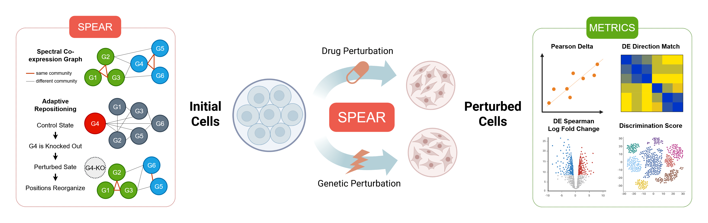
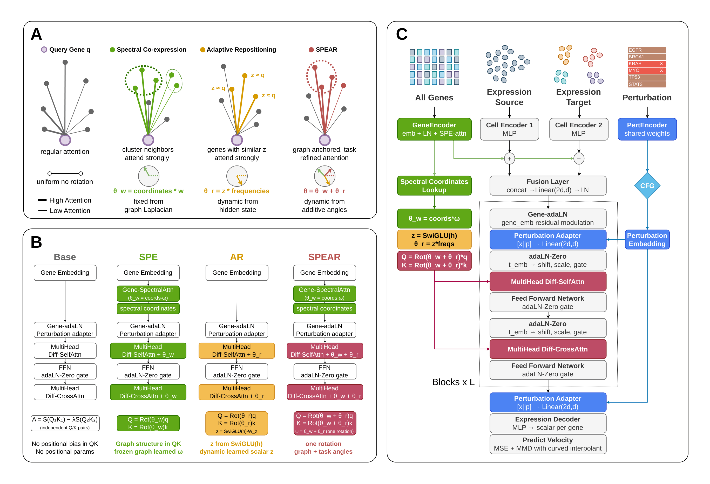

# SPEAR: Spectral Adaptive Repositioning for Flow-Based Single-Cell Perturbation Modeling

[](https://openreview.net/pdf?id=QSGanMEcUV)
[](https://neurips.cc/virtual/2026/poster/152050)
[](https://openreview.net/forum?id=VsHXKYG0Sq)
[](https://github.com/shouryaverma/SPEAR)

Official code for the NeurIPS 2026 paper **Spectral Adaptive Repositioning for Flow-Based Single-Cell Perturbation Modeling**.

Shourya Verma\*, Mengbo Wang\*, Simran Kadadi\*, Nadia Atallah Lanman, Shahin Mohammadi, Ananth Grama

Purdue University, Broad Institute. \*Equal contribution.

<p align="center">
  
</p>

**Left:** a knockout (G4) collapses hub connections and reorganizes the positional structure of the remaining genes. **Center:** SPEAR maps unperturbed cell populations to perturbed cell states under drug and genetic perturbations via a learned flow. **Right:** evaluation metrics.

## Overview

Transformers need a notion of position, and genes have none. Integer indices are arbitrary, rank-based orderings discard topology, and static co-expression attention masks are identical for every cell and every perturbation, so they cannot represent the way a knockout rewires gene-gene relationships.

SPEAR replaces sequential positional encodings and binary attention masks with two complementary rotary mechanisms, summed into a single rotation angle applied to queries and keys at every backbone attention operation:

- **Spectral co-expression encoding (SPE).** Each gene is embedded at continuous coordinates given by the low-frequency eigenvectors of the normalized Laplacian of the top-k co-expression graph. A learnable per-head frequency tensor `Omega` of shape `H x (d_h/2) x K` maps these coordinates to rotation angles, so each head can specialize to a different scale of co-expression community structure.
- **Adaptive repositioning (AR).** At every layer, each gene's perturbation-conditioned hidden state is projected through a SwiGLU gate to a scalar position per head, then expanded to rotary angles at geometric frequencies. Attention geometry reorganizes with the perturbation, with no supervision on gene-gene relationships.

Both are trained inside a perturbation-conditioned flow matching model with a differential-attention Perceiver backbone, a curved training interpolant, and an unbiased multi-scale MMD endpoint loss. Inference integrates the learned velocity field with RK4 and classifier-free guidance.

<p align="center">
  
</p>

## Results

DE Spearman-LFC (Spearman correlation of predicted vs. true log fold change on ground-truth differentially expressed genes), the primary quantity of interest in perturbation modeling:

| Dataset / split | Best prior | SPEAR |
|---|---|---|
| ComboSciPlex (drugs) | 0.8289 (scDFM) | **0.8962** |
| Norman, single holdout | 0.6957 (scDFM) | **0.8119** |
| Norman, double holdout | 0.5676 (scDFM) | **0.7651** |
| Norman, additive | 0.5705 (scDFM) | **0.8665** |
| Parse-PBMC (cytokines) | 0.6071 (STATE) | **0.6777** |

SPEAR also leads on MSE, MAE, Direction Match, and Discrimination Score on most benchmarks. Full tables, five-seed confidence intervals, positional controls (permuted and freely learned coordinates), and the biological analysis (TRRUST precision, pathway recovery, flow-time repositioning) are in the paper.

## Installation

```bash
git clone https://github.com/shouryaverma/SPEAR.git
cd SPEAR
conda env create -f environment.yml
conda activate <env_name_from_environment.yml>
export PYTHONPATH=.
```

## Dataset download

Put the datasets into the `data/` folder (it may be a symlink to a shared location).

- [Norman](https://figshare.com/articles/dataset/Norman_et_al_2019_Science_labeled_Perturb-seq_data/24688110)
- [ComboSciPlex subset of sciplex v3](https://figshare.com/articles/dataset/combosciplex/25062230?file=44229635)
- [Parse-PBMC (10 million PBMC cytokine screen)](https://www.parsebiosciences.com/datasets/10-million-human-pbmcs-in-a-single-experiment/). We use the splits of [STATE](https://github.com/ArcInstitute/state), so the Parse-PBMC data and split configuration should be obtained following the STATE repository.
- [Replogle K562 Perturb-seq (via scPerturb)](http://projects.sanderlab.org/scperturb/), only needed to run the `replogle` experiments in `run_experiments.sbatch`.

### Alternative data access

The Norman and ComboSciPlex datasets, together with the Norman data splits, are also available from the [scDFM Google Drive folder](https://drive.google.com/drive/folders/1cNpYAt9jVWZN82miNZtkP10YeSo7hufL?usp=sharing). The Norman and ComboSciPlex results in our paper use the exact dataset splits and fixed seed of [scDFM](https://github.com/AI4Science-WestlakeU/scDFM), and the Parse-PBMC results use those of STATE.

Example directory layout after download (relative to the repository root):

```
SPEAR/
├─ data/
│  ├─ norman.h5ad
│  ├─ combosciplex.h5ad
│  └─ ...
├─ src/
│  └─ ...
└─ run_experiments.sbatch
```

Supported datasets (`--data_name`):

| Name | Perturbation | Cell type |
|---|---|---|
| `norman` | CRISPRa, single and double genes | K562 |
| `replogle` | CRISPR knockdown | K562 |
| `combosciplex` | Drug combinations | A549 |
| `parse_pbmc` | Cytokines | Human PBMC |

Gene vocabularies for each dataset are in `src/tokenizer/`.

Two derived files are built automatically on first use and cached under `data/<dataset>/`:

- the top-k co-expression neighbor mask: `mask_fold_<fold>topk_30<split>_negative_edge.pt`
- the spectral coordinates (Laplacian eigenvectors): the same name with `_wire_eigvecs.pt`

Both are computed from the training split only.

Split methods (`--split_method`):

- `additive`: every single perturbation in a held-out combination is seen in training; tests generalization to unseen combinations.
- `holdout`: selected perturbations and all combinations containing them are removed from training; tests extrapolation to unseen perturbation identities.
- `state_pbmc`: the Parse-PBMC split used by STATE.

## Training

Single run:

```bash
mkdir -p logs

python src/script/run.py \
  --data_name=norman --split_method=additive --fold=0 \
  --model_type=origin --fusion_method=differential_perceiver --mode=predict_y \
  --d_model=128 --batch_size=48 --lr=5e-5 --eta_min=1e-6 --steps=200000 \
  --n_top_genes=5000 --infer_top_gene=1000 --topk=30 --use_negative_edge \
  --perturbation_function=crisper --noise_type=Gaussian \
  --endpoint_loss=mmd --gamma=0.5 \
  --use_wire --use_repo \
  --seed=42 --result_path=./result 2>&1 | tee logs/norman_additive_s42.log
```

Use `--perturbation_function=drug` for `combosciplex` and `parse_pbmc`.

Model variants from the ablation:

| Variant | Flags |
|---|---|
| Base | neither `--use_wire` nor `--use_repo` |
| SPE | `--use_wire` |
| AR | `--use_repo` |
| SPEAR | `--use_wire --use_repo` |

Each run writes to a directory under `--result_path` named from its configuration (dataset, split, fold, loss, flags, seed). Checkpoints and evaluations are stored per iteration as `iteration_<step>/`, with metrics in `results.csv`. Interrupted runs resume from the latest checkpoint.

### Slurm

`run_experiments.sbatch` is the single entry point for every experiment. It builds a job table, runs one task per array index, skips finished runs, resumes interrupted ones, and requeues itself before the wall-time limit. Cluster-specific settings are not hardcoded; pass your account and partition at submission from the repository root:

```bash
mkdir -p logs
bash run_experiments.sbatch count                                   # number of jobs in the table
sbatch -A <account> -p <partition> run_experiments.sbatch           # tasks 0-16
sbatch -A <account> -p <partition> --array=0-106 run_experiments.sbatch    # everything
sbatch -A <account> -p <partition> --array=17-106 run_experiments.sbatch   # endpoint-loss matrix only
```

Optional environment variables: `REPO_DIR` (default: the submission directory), `CONDA_ENV` (default: the name in `environment.yml`), `CONDA_MODULE` (module that provides conda, loaded only if conda is not on `PATH`), and `WARM_CACHE`. Job logs are written to `logs/`.

To avoid recompiling the model at the start of every job, build the compiler cache once on a GPU node before submitting:

```bash
bash warm_inductor_cache.sh [data] [split] [fold]
```

## Endpoint loss and mechanism-shift options

Beyond the MMD loss used in the paper, the codebase exposes additional endpoint distribution losses and a sparse additive mechanism-shift head:

| Option | Values |
|---|---|
| `--endpoint_loss` | `mmd`, `deg_mmd`, `sinkhorn`, `deg_sinkhorn`, `max_sliced`, `deg_max_sliced`, `precision_sinkhorn`, `deg_sinkhorn_sparse`, `none` |
| `--use_samsvae` | enable the SAMS-VAE sparse additive mechanism shift head (gene-perturbation datasets) |
| `--samsvae_mask_prior` | `concrete` or `l1` |
| `--samsvae_latent_dim`, `--samsvae_lambda_mask`, `--samsvae_lr`, `--samsvae_warmup_steps` | head hyperparameters |

All options are defined in `config/config_flow.py`.

## Hyperparameters

| | |
|---|---|
| Model width `d_model` | 128 |
| Attention heads / backbone layers | 8 / 8 |
| Spectral dimension `K` | 32 |
| Co-expression top-k | 30 |
| Highly variable genes / genes per forward pass | 5000 / 1000 |
| Batch size | 48 |
| Optimizer / schedule | Adam, `5e-5`, cosine annealing to `1e-6` |
| Training steps | 200K |
| MMD weight `gamma` / kernel scales | 0.5 / {0.5, 1, 2, 4} |
| CFG dropout / guidance scale | 0.05 / 1.5 |
| Inference | RK4, 20 steps |

## Repository structure

```
SPEAR/
├── assets/                   figures
├── config/
│   └── config_flow.py        run configuration and result path naming
├── src/
│   ├── data_process/         data loading, split construction, co-expression
│   │                         graph and spectral coordinate precomputation
│   ├── flow_matching/        paths, solvers, and optimal transport utilities
│   ├── models/               SPEAR backbone (src/models/origin)
│   ├── script/run.py         training and evaluation entry point
│   ├── tokenizer/            per-dataset gene vocabularies
│   └── utils/
├── environment.yml
├── run_experiments.sbatch    experiment table and Slurm entry point
└── warm_inductor_cache.sh    one-time compiler cache build
```

## Citation

If you find our work and/or our code useful, please cite us via:

```bibtex
@inproceedings{verma2026spear,
  title     = {Spectral Adaptive Repositioning for Flow-Based Single-Cell Perturbation Modeling},
  author    = {Verma, Shourya and Wang, Mengbo and Kadadi, Simran and Lanman, Nadia Atallah and Mohammadi, Shahin and Grama, Ananth},
  booktitle = {Advances in Neural Information Processing Systems},
  year      = {2026},
  url       = {https://openreview.net/forum?id=VsHXKYG0Sq}
}
```

## Acknowledgments

SPEAR builds on the flow matching and differential transformer formulation of [scDFM](https://github.com/AI4Science-WestlakeU/scDFM). Benchmarks follow the splits and evaluation protocols of scDFM and STATE.